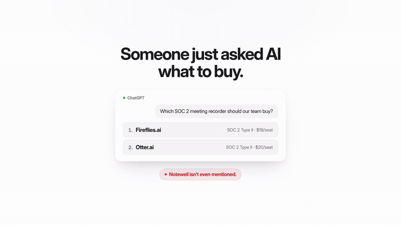

# Hearsay

Open-source AI visibility and citation measurement with confidence intervals, verbatim answer
receipts, and page-change lead tracking — run in your browser or by the AI assistant you already use.

[](https://melonwer.github.io/hearsay/)

**[Explore the Interactive Live Demo & Watch the 51-Second Film →](https://melonwer.github.io/hearsay/)**

[](https://github.com/melonwer/hearsay/actions/workflows/ci.yml)
[](LICENSE)
[](package.json)
[](package.json)
[](mcp/server.mjs)

## Why Hearsay Exists

Buyers ask ChatGPT, Claude, Gemini, and Perplexity what to buy before they ever visit your site.
Most $99–$399/mo trackers collapse noisy answers into one synthetic "AI score" while locking each
engine behind another tier.
Hearsay samples real routes repeatedly, reports honest error bars, preserves every search and
citation receipt, and tracks whether page changes move leads against an unchanged control page.

| What matters | Typical $99–$399/mo Trackers | Hearsay (MIT, Local-First) |
| --- | --- | --- |
| **Headline metric** | Single blended "AI Score" & fake rank badge | Answer & share-of-voice rates with **Wilson 95% confidence intervals** (`n` shown) |
| **Prompt sensitivity** | One fixed prompt per keyword (hides paraphrase drift) | Multi-paraphrase **buyer intents** splitting phrasing spread vs. rerun spread |
| **Surface honesty** | Mixes unsearched completions with live search | Unblended per-route series (`OpenAI`, `Claude`, `Gemini`, `Perplexity`, `Codex`, `Claude Code`, `Antigravity`) |
| **Evidence receipts** | Summary charts without raw provenance | **Verbatim receipts**: prompt, search query, returned URLs vs. cited URLs, and citation gaps |
| **Business outcomes** | Stops at mention counts | Links shipped page changes to reported leads/sales vs. an **unchanged control page** |
| **Client reporting & lock-in** | Per-seat and per-engine paywalls | **1-click shareable HTML/PDF B2B client reports**, local SQLite, full JSON/CSV export |

## Choose Your Door (30-Second Quickstart)

### Option A — Browser Workbench (Founders, Marketers & Agencies)

No `.env` file, `npm install`, or API keys needed to explore. Install [Node.js ≥ 22.13](https://nodejs.org)
(uses built-in `node:sqlite`), then run:

```sh
git clone https://github.com/melonwer/hearsay && cd hearsay
node server.js
```

*(Prefer not to use Git? Click **Code → Download ZIP** above, unzip, and run `node server.js`.)*

Open the local URL printed in your terminal:

1. Click **Explore Interactive Notewell Demo** in 1 click, or stay in your live brand workspace.
2. Paste provider API keys or toggle signed-in local CLI routes (`Codex`, `Claude Code`) right in the
   browser UI (saved locally to `.env` with `0600` permissions).
3. Approve your buyer intents, review the pre-run API cost quote, run your audit, and click
   **Export Client Report** for a self-contained dark/light/printable HTML/PDF report.

### Option B — Your AI Assistant (Claude Code, Codex, Antigravity)

Paste this prompt into your coding assistant to run an evidence-backed website study (stored in
`.hearsay/<app-id>/`) with zero server setup:

> Install Hearsay from https://github.com/melonwer/hearsay and study my product. Use what you
> already know, ask for missing details, check available providers, and propose buyer questions,
> usage limits, and a schedule. Show me the actual plan before enabling collection.

Or inspect local routes, install host plugins, and register the built-in MCP server directly:

```sh
node bin/hearsay.js doctor                                   # inspect runtime & installed agent routes
node scripts/build-bundles.js                                # build portable, Codex, Claude & Gemini bundles
codex plugin marketplace add "$PWD/dist/codex" && codex plugin add hearsay@hearsay-local
claude plugin marketplace add "$PWD/dist/claude" && claude plugin install hearsay@hearsay-local
codex mcp add hearsay -- node "$PWD/mcp/server.mjs"          # optional: connect Codex to local workbench
claude mcp add -s user hearsay -- node "$PWD/mcp/server.mjs" # optional: connect Claude Code to workbench
```

See [Skill & Plugin Installation](skill/references/installation.md) for portable skill, Codex/Claude
plugins, and Gemini CLI extension bundles, and [Setup & Provider Reference](docs/setup-reference.md)
for search policies and CLI runner flags.

## Dashboard Preview

<p>
  
  
</p>

Dark and light themes — select any exact measurement series to inspect its comparable answer receipts,
citation gaps, and exportable client report.

## How It Works in 4 Steps

1. **Draft Buyer Intents** — Express each non-branded buying job in multiple paraphrases
   ([arXiv:2605.27440](https://arxiv.org/pdf/2605.27440) shows rewording drops brand overlap to
   14–29% vs. 50–61% on identical reruns) and approve exact prompts before spending a cent.
2. **Measure Repeatedly Across Real Routes** — Sample direct APIs (with opt-in verified web search)
   or signed-in `Codex`, `Claude Code`, and `Antigravity` CLIs; every route, model, and search policy
   stays an unblended directional series with Wilson 95% intervals.
3. **Inspect Verbatim Citation Receipts** — Keep exposed search queries, returned search URLs, and
   final-answer citations separate so you can spot citation gaps where third-party comparisons or
   docs cite competitors instead of you.
4. **Track Page Changes & Leads Against a Control Page** — Record shipped updates in
   **Opportunities** and business results in **Weekly Review** to compare changed-page vs. unchanged
   control-page outcomes and bound background drift without faking causal attribution.

## Local-First, Zero Lock-In

- **Your machine, your SQLite file:** Live data stays in `data/hearsay.db` (separate from the
  fictional demo in `data/demo/hearsay.db`); website studies live in `.hearsay/<app-id>/`.
- **Transparent costs:** Hearsay has no hosted fee or gated tier. Direct API calls are billed by
  your configured providers (previewed before every run); signed-in CLI runs use your plan allowance.
- **Full portability:** Export client-ready HTML/PDF reports (`GET /api/export/report`), outcome
  CSVs, or the entire database as JSON (`GET /api/export`) at any time. Zero telemetry.

## Documentation Map

- **[Methodology](METHODOLOGY.md)** — Wilson 95% intervals, phrasing vs. rerun variance, route
  boundaries, and what Hearsay refuses to fake.
- **[Setup, Providers & API Reference](docs/setup-reference.md)** — Direct API search policies,
  subscription CLI runners, quotes & schedule consent, MCP config, Linux `systemd` service, and
  HTTP JSON endpoints.
- **[Agent Skill & Website Studies](skill/SKILL.md)** — Conversational product audits,
  `.hearsay/<app-id>/` workspaces, and [plugin/bundle installation](skill/references/installation.md).
- **[Evidence Report Guide](docs/evidence-report.md)** — Search actions, exposed queries, source
  observations, final-answer citations, and denominators.
- **[Opportunities & Page Comparisons](docs/opportunities.md)** — Shortlisting citation gaps,
  recording shipped changes, and [frozen baseline comparisons](docs/intervention-comparison.md).
- **[Business Outcomes & Weekly Review](docs/outcomes.md)** — Manual/CSV outcome tracking,
  changed-vs-control page comparisons, and weekly review exports.
- **[Security](SECURITY.md)** & **[Contributing](CONTRIBUTING.md)** — Localhost trust boundary,
  `0600` secret handling, zero-telemetry design, and zero-dependency rules.

---

[MIT License](LICENSE). Not affiliated with OpenAI, Anthropic, Google, or Perplexity; trademarks belong to their owners.
