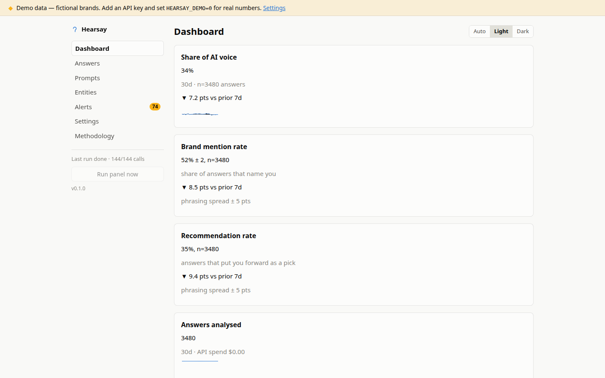

# Hearsay

**Find out why AI recommends your competitors instead of you — with receipts, not a fake 0–100 score.**

Hearsay is an open-source, lightweight AI-search forensics kit for technical SEOs and builders
(Node 22 built-ins + strict 2-package pure-JS extraction allowlist: `webforai` and `diff`, with
zero-dependency built-in fallbacks). Run a 10-second crawlability X-ray with zero API keys, test
real buyer questions across APIs, signed-in coding CLIs, or plug-and-play Google/ChatGPT scrapers,
and see which pages AI read, dropped, or cited instead of yours. Local SQLite (`node:sqlite`), no
subscriptions, zero telemetry.

[](https://melonwer.github.io/hearsay/)

**[See the interactive demo and the 51-second film](https://melonwer.github.io/hearsay/)**

[](https://www.npmjs.com/package/@melonwer/hearsay)
[](https://github.com/melonwer/hearsay/actions/workflows/ci.yml)
[](LICENSE)
[](package.json)
[-blue.svg)](package.json)
[](mcp/server.mjs)

---

## Try it in 10 seconds (zero API keys)

Before spending a dollar on prompts, check what zero-JS AI crawlers (`OAI-SearchBot`, `Claude-SearchBot`,
`PerplexityBot`, `ClaudeBot`, `GPTBot`, and 13 more) actually see across your site — and compare
directly against competitors:

```sh
npx @melonwer/hearsay check https://yoursite.com --browser --vs https://competitor.com
```

```text
Hearsay Site Pre-Flight Check  https://yoursite.com  (200 OK · 15 audited | 0 skipped | 0 errored)
──────────────────────────────────────────────────────────────────────────────────────────────────
Stack / Edge              Vite SPA | CDN: Cloudflare | WAF: bot_management_active
AI Crawlers (robots.txt)  18/18 allowed (OAI-SearchBot, Claude-SearchBot, PerplexityBot…)
Raw HTML visible words    0 words  (SPA shell #root detected · Hard Gate: NOT OBSERVED)
Rendered DOM (--browser)  1,167 words · 16 headings  [Prose Parity 0% · 16 missing headings]
Status                    FAIL [BLOCKED_HARD_GATE] — copy-paste Vite SSR/prerender recipe included
```

By default `hearsay check` audits up to 15 template-diverse key pages (`--max-pages 15`, or pass
`--single` for one URL), probes `Accept: text/markdown` negotiation, clusters issues by template
(`"fix 1 template → fix N pages"`), compares against `--vs` competitors, and enforces CI quality
gates (`--fail-on critical|attention`, `--baseline`, `--check-caching`, `--ignore-robots-for-own-site`,
exit code `10`). Add `--html preflight.html` for a self-contained side-by-side Bot-vs-Human visual
diff report or `--json` for CI. Requires [Node.js 22.13+](https://nodejs.org) — no `.env` needed.

---

## Why people bounce from $99–$500/mo AI visibility tools

Paid GEO dashboards collapse noisy, probabilistic answers into one opaque "AI score." When a client
checks ChatGPT on their phone and sees a different answer, the report looks made up — and the score
still never tells you *what to fix*.

Hearsay replaces black-box scores with **four deterministic forensics checks**:

1. **10-Second Crawlability & Bot-vs-Human X-Ray (`hearsay check`)**
   Multi-page key-page audit (default 15 pages, `--single` for 1 URL): RFC 9309 `robots.txt` across
   18 AI & search crawlers + 3 policy signals (catching Cloudflare Managed overrides, `Content-Signal`
   conflicts, and `__usage_ai-training`), passive stack/CDN/WAF fingerprinting, `Accept: text/markdown`
   and `Vary: Accept` cache-poisoning checks, exact UTF-8 byte offsets & Payload-to-Prose / Next.js
   RSC bloat forensics, side-by-side Bot-vs-Human Markdown diffs (`--browser`), template clustering,
   stack-specific copy-paste remediation, `--vs` Competitor X-Ray, and CI gating (`--fail-on`,
   `--baseline`).
2. **Retrieved-but-Dropped Attrition & Own-Site Hijacks**
   AI search typically drops ~85% of the pages it retrieves before writing an answer — and often
   cites *your* page while recommending a *competitor*. Hearsay separates retrieved URLs from final
   citations and flags every dropped own-page and competitor hijack with the verbatim receipt.
3. **Memory vs. Live Search Delta**
   Runs the exact same prompts with web search **OFF** vs. **ON** (strictly within the same model)
   so you know whether a brand is anchored in model weights, only shows up when live search fires,
   or gets displaced by search results.
4. **Durable Off-Site Targets (Citation Persistence)**
   Most cited URLs are third-party pages, and the majority churn week to week. Across multiple waves,
   Hearsay filters out one-off noise and ranks the **recurring third-party domains** that repeatedly
   drive competitor recommendations — refusing to fake durability on a single wave.

---

## Paid trackers vs. Hearsay

| | Typical $99–$500/mo SaaS | Hearsay |
| --- | --- | --- |
| **Crawlability** | Generic checklist or spoofed bot probes | Zero-key `hearsay check`: 18-bot `robots.txt`, multi-page template crawl, stack/WAF + copy-paste fixes, Bot-vs-Human diff, `--vs` X-Ray & CI gate |
| **Headline metric** | One blended 0–100 score | Separate Mention, Citation & Positive Recommendation rates with Wilson 95% CIs (`n` shown) |
| **Prompt variance** | One fixed prompt per keyword | Multiple paraphrases per intent, splitting wording spread from rerun spread |
| **Retrieval forensics** | Mentions only | Retrieved-but-Dropped attrition + Own-Site Hijack receipts |
| **Memory vs. search** | Mixed silently | Paired `search=off` vs. grounded delta per `(provider, model)` |
| **Off-site targets** | Noisy single-day URL dumps | Multi-wave Citation Persistence (`durable`, `recurring`, `ephemeral`, or `single_wave_unverified`) |
| **Engines & cost** | Per-seat / per-engine paywalls | Direct APIs, BYOK **DataForSEO** (`google-aio` + `chatgpt-web`), $0 signed-in CLIs (`Codex`, `Claude Code`, `Antigravity`), hard monthly USD cap |
| **Data & reports** | Hosted lock-in | Local SQLite, white-label HTML/PDF Evidence Dossiers, 45 MCP tools, GitHub Actions weekly waves |

---

## What Hearsay refuses to fake

- **No blended 0–100 "AI visibility score."** Mentions, citations, positive stance, and sample size stay separate so you can see the real failure mode.
- **No fake UA-spoofing WAF checks.** `hearsay check` identifies itself honestly (`HearsaySiteCheck/0.1`) instead of spoofing `GPTBot` or `OAI-SearchBot` (CDNs verify AI crawlers by IP/rDNS, so spoofed probes create false positives).
- **No `llms.txt` or schema-markup scorecards.** Hearsay reports verifiable HTML facts rather than grading pages on unproven checklist myths.
- **No single-wave durability claims.** With only 1 wave on disk, every cited URL stays `single_wave_unverified`.
- **No invented prompt volumes or fake rankings.** Reports include a plain-English *"Why Live Chat on Your Phone May Differ"* box backed by your actual confidence intervals.

---

## Dashboard

<p>
  
  
</p>

---

## Quickstart

### In your browser (local workbench + interactive demo)

```sh
git clone https://github.com/melonwer/hearsay && cd hearsay
node server.js
```

Or run directly without cloning: `npx @melonwer/hearsay serve` (no Git? Use **Code → Download ZIP**, unzip, and run `node server.js`).

Open the local URL printed in your terminal, then:

1. Click **Explore Interactive Notewell Demo**, or start in your own SQLite workspace.
2. Connect any mix of routes:
   - **Direct APIs:** `OPENAI_API_KEY`, `ANTHROPIC_API_KEY`, `GEMINI_API_KEY`, `PERPLEXITY_API_KEY`
   - **Plug-and-play consumer surfaces (BYOK):** `DATAFORSEO_LOGIN` / `DATAFORSEO_PASSWORD` for **Google AI Overviews** and **ChatGPT Web** (with geolocation + pre-wave health canary)
   - **$0 marginal-cost signed-in CLIs:** `Codex`, `Claude Code`, or `Antigravity`
   - Secrets stay on your machine in `.env` (`0600` permissions).
3. Set an optional hard monthly USD kill-switch (`HEARSAY_MONTHLY_USD_CAP`), approve your buyer questions, run a wave, and export a **white-label HTML/PDF Evidence Dossier**.

### In your AI assistant (Claude Code, Codex, Antigravity)

Paste this into your coding assistant — studies live in `.hearsay/<app-id>/` with no server needed:

> Install Hearsay from https://github.com/melonwer/hearsay and study my product. Run a technical
> pre-flight check first, infer what you already know, ask only for material unknowns, check
> available providers, and propose buyer questions, spend limits, and a schedule before enabling
> collection.

Or wire up the skill bundles and 45-tool MCP server directly:

```sh
node bin/hearsay.js doctor                                   # inspect runtime and agent routes
node scripts/build-bundles.js                                # build portable, Codex, Claude, Gemini bundles
codex plugin marketplace add "$PWD/dist/codex" && codex plugin add hearsay@hearsay-local
claude plugin marketplace add "$PWD/dist/claude" && claude plugin install hearsay@hearsay-local
codex mcp add hearsay -- node "$PWD/mcp/server.mjs"          # MCP for Codex
claude mcp add -s user hearsay -- node "$PWD/mcp/server.mjs" # MCP for Claude Code
```

### Automated weekly waves (no sleeping-laptop cron)

Use the opt-in GitHub Actions workflow in [`.github/workflows/hearsay-wave.yml`](.github/workflows/hearsay-wave.yml) to run bounded weekly waves with `HEARSAY_MONTHLY_USD_CAP` and upload the HTML Evidence Dossier + SQLite bundle as build artifacts.

---

## Documentation

- [Methodology](METHODOLOGY.md): Wilson intervals, wording vs. rerun spread, retrieval attrition, own-site hijacks, memory-vs-search pairing, citation persistence, and site pre-flight design
- [Setup and provider reference](docs/setup-reference.md): `hearsay check` flags, BYOK DataForSEO, geolocation, `HEARSAY_MONTHLY_USD_CAP`, `HEARSAY_ALLOW_UNVERIFIED_MODELS`, white-label report exports, weekly CI waves, MCP, and HTTP API
- [Agent skill and website studies](skill/SKILL.md): conversational audits, forensics MCP tools, and `.hearsay/<app-id>/` workspaces
- [Evidence report guide](docs/evidence-report.md): search actions, sources, citations, and denominators
- [Opportunities](docs/opportunities.md) and [page comparisons](docs/intervention-comparison.md): from citation gap to shipped change
- [Business outcomes](docs/outcomes.md): lead tracking, control pages, and weekly review exports
- [Security](SECURITY.md) and [Contributing](CONTRIBUTING.md)

---

[MIT License](LICENSE). Not affiliated with OpenAI, Anthropic, Google, Perplexity, or DataForSEO. Trademarks belong to their owners.
