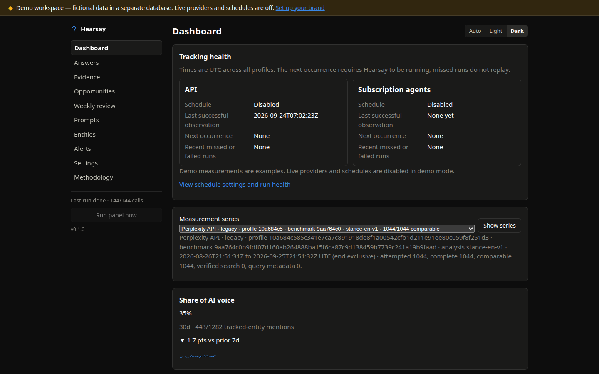

# Hearsay

**Open-Source AI-Search Forensics & Measurement for Technical SEOs and Builders.**

Find out why AI engines crawl your pages, drop your citations, or recommend competitors instead of
you. Hearsay pairs a 10-second zero-key technical crawlability pre-flight audit with verbatim
retrieval-vs-citation receipts, paired memory-vs-search deltas, multi-wave off-site citation
persistence, and control-page outcome tracking — zero external runtime dependencies, local SQLite
(`node:sqlite`), and runnable from your CLI, browser, GitHub Actions, or coding assistant.

[](https://melonwer.github.io/hearsay/)

**[See the interactive demo and the 51-second film](https://melonwer.github.io/hearsay/)**

[](https://github.com/melonwer/hearsay/actions/workflows/ci.yml)
[](LICENSE)
[](package.json)
[](package.json)
[](mcp/server.mjs)

## Quickstart

Requires [Node.js 22.13+](https://nodejs.org) (uses built-in `node:sqlite`). Zero `npm install`,
`.env` file, or API keys needed to start.

### 1. 10-second zero-key pre-flight audit

Check what AI search crawlers actually see in your raw HTML before spending a cent on prompts:

```sh
npx hearsay check https://yoursite.com
```

Add `--html preflight.html` for a printable report, `--json` for CI pipelines, or `--browser` to
compare raw HTML against a local headless Chromium/Playwright DOM render. From a git checkout, run
`node bin/hearsay.js check https://yoursite.com`.

### 2. Local forensics dashboard

Launch the local web workbench (includes the interactive **Notewell** demo workspace out of the
box, or switch to your own live SQLite workspace in one click):

```sh
npx hearsay serve
```

Or from a git checkout:

```sh
git clone https://github.com/melonwer/hearsay && cd hearsay
node server.js
```

Open the local URL printed in your terminal, then:

1. Click **Explore Interactive Notewell Demo**, or start in your own workspace.
2. Add direct API keys (`OPENAI_API_KEY`, `ANTHROPIC_API_KEY`, `GEMINI_API_KEY`,
   `PERPLEXITY_API_KEY`), optional BYOK **DataForSEO** credentials (`DATAFORSEO_LOGIN` /
   `DATAFORSEO_PASSWORD` for Google AI Overview & ChatGPT Web), or signed-in CLI routes (`Codex`,
   `Claude Code`). Secrets are saved locally to `.env` with `0600` permissions.
3. Set an optional hard monthly spend cap (`HEARSAY_MONTHLY_USD_CAP`), approve your buyer
   questions, review the pre-run quote, run a measurement wave, and click **Export Client Report**.

No Git? Use **Code → Download ZIP**, unzip, and run `node server.js`.

### 3. In your AI assistant (Claude Code, Codex, Antigravity)

Paste this into your coding assistant. Studies are stored in `.hearsay/<app-id>/`, with no server
to set up:

> Install Hearsay from https://github.com/melonwer/hearsay and study my product. Run a technical
> pre-flight check first, infer what you already know, ask only for material unknowns, check
> available providers, and propose buyer questions, spend limits, and a schedule before enabling
> collection.

Or install the skill bundles and built-in MCP server directly:

```sh
node bin/hearsay.js doctor                                   # inspect runtime and agent routes
node scripts/build-bundles.js                                # build portable, Codex, Claude, Gemini bundles
codex plugin marketplace add "$PWD/dist/codex" && codex plugin add hearsay@hearsay-local
claude plugin marketplace add "$PWD/dist/claude" && claude plugin install hearsay@hearsay-local
codex mcp add hearsay -- node "$PWD/mcp/server.mjs"          # MCP for Codex
claude mcp add -s user hearsay -- node "$PWD/mcp/server.mjs" # MCP for Claude Code
```

More in [Skill and plugin installation](skill/references/installation.md) and the
[Setup and provider reference](docs/setup-reference.md).

## What Hearsay shows that $99–$500/mo SaaS hides

Most paid AI-visibility trackers collapse noisy stochastic answers into a single opaque score. A
score cannot tell you whether your page was dropped between retrieval and citation, whether a
competitor hijacked your own documentation, or whether a third-party URL is worth outreach.
Hearsay keeps the receipts and runs deterministic forensics over them.

| | Typical $99–$500/mo SaaS | Hearsay |
| --- | --- | --- |
| Technical pre-flight | Generic checklist or fake spoofed bot checks | Zero-key `hearsay check <url>`: RFC 9309 `robots.txt` for 9 crawlers, UTF-8 byte-offset truncation cliffs (30/100/300 KB), CSR empty-shell risk, optional `--browser` DOM diff, honest UA |
| Headline metrics | One blended 0–100 "AI score" | Separate Mention, Citation, and Positive Recommendation rates with Wilson 95% intervals (`n` shown) and wording-vs-rerun spread |
| Retrieval forensics | Final mentions only | **Retrieved-but-Dropped attrition** (`source_observations` vs. `answer_citations`) by domain ownership (`brand_owned`, `competitor_owned`, `third_party`) + **Own-Site Hijack** receipts |
| Memory vs. live search | Mixed silently | **Paired Parametric Memory vs. Grounded Retrieval Delta** strictly within the same `(provider, model)` (`memory_anchored`, `search_dependent`, `memory_displaced`, `absent_in_both`) |
| Off-site earned media | Single-snapshot domain lists | **Multi-wave Citation Persistence** (`wavesSeen / totalWaves`: `durable`, `recurring`, `ephemeral`, or `single_wave_unverified`) ranking brand-absent third-party outreach targets |
| Engines & surfaces | Per-seat / per-engine upsells | Unblended series per route: OpenAI, Anthropic, Gemini, Perplexity, BYOK **DataForSEO** (`google-aio` & `chatgpt-web`), plus signed-in `Codex`, `Claude Code`, and `Antigravity` CLIs |
| Cost control & storage | Hosted subscription, opaque limits | Pre-run quotes, hard UTC monthly USD kill-switch (`HEARSAY_MONTHLY_USD_CAP`), zero-dep local SQLite (`node:sqlite`), white-label HTML/PDF Evidence Dossiers, opt-in GitHub Actions weekly waves |

## What Hearsay refuses to fake

These are deliberate engineering and epistemic boundaries, not roadmap gaps:

- **No blended 0–100 "AI visibility score."** Collapsing mentions, citations, positive stance, and
  sampling uncertainty into one composite number hides the exact failure mode you need to fix.
- **No fake UA-spoofing WAF claims.** `hearsay check` identifies itself honestly as
  `HearsaySiteCheck/0.1` and never spoofs `GPTBot` or `OAI-SearchBot`. Cloudflare, Akamai, and
  Fastly verify AI crawlers via published IP ranges, reverse DNS (rDNS), or cryptographic
  signatures — so Hearsay explicitly directs you to verify real bot reachability in CDN/origin logs.
- **No `llms.txt` or schema-markup scorecards.** Hearsay reports verifiable raw-HTML structure
  (headings, tables, JSON-LD types, byte offsets) instead of grading pages on unproven checklist
  myths.
- **No single-wave durability claims.** On 1 completed measurement wave, Hearsay marks every cited
  URL and domain `single_wave_unverified` and refuses to fabricate churn or durability tiers.
- **No invented prompt volumes or fake rank positions.** AI answers are stochastic streams, not
  deterministic ranked SERPs, and nobody has real prompt-volume logs across closed chat apps.

## Dashboard

<p>
  
  
</p>

## How it works

1. **Audit crawlability before measuring.** Run `npx hearsay check https://yoursite.com` to catch
   `robots.txt` blocks, `noindex` directives, long/geo redirect chains, CSR empty shells, and
   raw-HTML truncation cliffs (`>30 KB` / `>100 KB` / `>300 KB`) in seconds with zero API keys.
2. **Write paraphrased buyer questions.** Each buying intent gets several paraphrases, because
   rewording alone drops brand overlap to 14–29% versus 50–61% on identical reruns
   ([arXiv:2605.27440](https://arxiv.org/pdf/2605.27440)). You approve exact wording before any
   collection runs.
3. **Run bounded, unblended waves.** Sample direct APIs (memory-only `off` or grounded
   `auto`/`required`), BYOK DataForSEO (`google-aio`, `chatgpt-web`), or signed-in `Codex`,
   `Claude Code`, and `Antigravity` CLIs — locally or unattended via
   [`.github/workflows/hearsay-wave.yml`](.github/workflows/hearsay-wave.yml) with
   `HEARSAY_MONTHLY_USD_CAP`.
4. **Inspect the forensics receipts.** Diagnose **Retrieved-but-Dropped** attrition, **Own-Site
   Hijacks**, **Memory vs. Search** deltas, and **Multi-Wave Citation Persistence** for off-site
   targets — in the web UI, via MCP tools in your coding agent, or in a white-label HTML/PDF
   Evidence Dossier.
5. **Ship a fix and compare.** Log page changes in **Opportunities** and business outcomes in
   **Weekly Review** against an unchanged control page, without overclaiming causation.

## Local-first & zero-dependency

- **Your data stays on your machine.** Live data is in `data/hearsay.db`; the fictional demo is in
  `data/demo/hearsay.db`; website studies are in `.hearsay/<app-id>/`.
- **Zero runtime dependencies.** Pure Node.js ≥ 22.13 standard library (`node:sqlite`, `node:http`,
  `node:crypto`) — auditable end to end with zero supply-chain bloat.
- **No hosted fee, hard spend guardrails.** Direct API and BYOK DataForSEO calls are billed by your
  providers, quoted before every run, and guarded by `HEARSAY_MONTHLY_USD_CAP`. Signed-in CLI runs
  use your existing plan.
- **Export anytime.** Self-contained white-label HTML/PDF Evidence Dossiers
  (`GET /api/export/report`), outcome CSVs, or full SQLite JSON backups (`GET /api/export`). Zero
  telemetry.

## Documentation

- [Methodology](METHODOLOGY.md): Wilson intervals, phrasing vs. rerun variance, retrieval attrition, own-site hijacks, memory-vs-search pairing, citation persistence, site pre-flight design, and what Hearsay refuses to fake
- [Setup and provider reference](docs/setup-reference.md): `hearsay check` flags, BYOK DataForSEO, geolocation, `HEARSAY_MONTHLY_USD_CAP`, `HEARSAY_ALLOW_UNVERIFIED_MODELS`, white-label report exports, GitHub Actions weekly waves, MCP, and HTTP API
- [Agent skill and website studies](skill/SKILL.md): conversational audits, forensics MCP tools, and `.hearsay/<app-id>/` workspaces
- [Evidence report guide](docs/evidence-report.md): search actions, sources, citations, and denominators
- [Opportunities](docs/opportunities.md) and [page comparisons](docs/intervention-comparison.md): from citation gap to shipped change
- [Business outcomes](docs/outcomes.md): lead tracking, control pages, and weekly review exports
- [Security](SECURITY.md) and [Contributing](CONTRIBUTING.md)

---

[MIT License](LICENSE). Not affiliated with OpenAI, Anthropic, Google, Perplexity, or DataForSEO. Trademarks belong to their owners.
